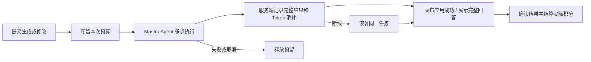

# FlowchartAI 计费 V1

当前状态：本地实现和 Waffo sandbox 验收完成；商户审核已提交，Under Review。未部署、未写线上用户余额、未迁移旧合同。

| 方案 | 月付 | 年付 | 额度 |
| --- | --- | --- | --- |
| Free | $0 | — | 注册一次 200 积分，30 天有效 |
| Starter | $9 | $90 | 每个订阅月 2,000 积分 |
| Pro | $19 | $190 | 每个订阅月 6,000 积分 |
| 积分包 | $10 / $30 | — | 1,500 / 5,000，永久有效，无会员要求 |

年付一次收款，每月发放当月积分，月度额度不结转。优先使用最早到期的额度；永久积分最后使用。套餐使用相同模型、生成和修改能力；手动编辑、保存、撤销、下载免费。

积分按整个任务的输入、缓存输入、输出 Token 汇总，只取整一次。DeepSeek V4 Pro 每 1,000 Token 为 2 / 0.2 / 4 积分。长上下文对应更高消耗；系统修复成本由平台承担。常规请求不额外确认，超过默认预算时先显示上限。不会超过已同意的预留额度扣费。

旧 Creem 用户保留原价、折扣、订阅周期、原生成次数权益、历史余额、续费与取消入口及原退款承诺。旧套餐内的请求不额外扣积分；用完原额度后可以使用积分。不会自动新开第二份订阅，也不会迁移付款授权。

真实 sandbox 完成了 $19 Pro 月付和 $10 积分包两笔测试支付；本地余额由 200 → 6,200 → 7,700。自动化检查与真实支付分开记录在 [验收记录](verification.md)。

[锁定范围](SPEC.md) · [正式切换说明](rollout.md) · [审核记录](waffo-review.md) · [旧权益只读审计](legacy-entitlement-audit.json)

复用现有 Next.js、Mastra 与 Postgres，不增加生产服务器或定时服务。Waffo 店铺审核中；生产商品/凭据、线上迁移和切换尚未执行。
