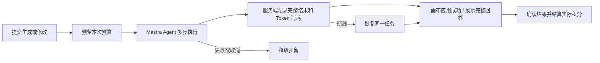

# FlowchartAI 计费 V1

当前状态（2026-10-14）：Waffo 审核已通过，新计费已在 [flowchartai.org](https://flowchartai.org) 上线。正式商品、凭据、webhook、追加迁移和旧权益快照已核对；正式账号的生成、修改、保存、下载与积分包收银台已验收。见 [生产发布回执](production-release-receipt.json)。

| 方案 | 月付 | 年付 | 额度 |
| --- | --- | --- | --- |
| Free | $0 | — | 注册一次 20 积分，30 天有效；历史已发放额度保留 |
| Starter | $9 | $84（折合 $7/月） | 每个订阅月 2,000 积分 |
| Pro | $19 | $180（折合 $15/月） | 每个订阅月 6,000 积分 |
| 积分包 | $10 / $30 | — | 1,500 / 5,000，永久有效，无会员要求 |

年付一次收款，每月发放当月积分，月度额度不结转。优先使用最早到期的额度；永久积分最后使用。套餐使用相同模型、生成和修改能力；手动编辑、保存、撤销、下载免费。

积分按整个任务的输入、缓存输入、输出 Token 汇总，只取整一次。DeepSeek V4 Pro 每 1,000 Token 为 2 / 0.2 / 4 积分。长上下文对应更高消耗；系统修复成本由平台承担。任务自动预留、成功后结算实际消耗，不弹出预算确认框；最终扣费不超过预留额度。

旧 Creem 用户保留原价、折扣、订阅周期、原 AI 请求次数权益、历史余额、续费与取消入口及原退款承诺。文字分析、生成和修改均按一次成功的用户请求计一次，Agent 内部多步不重复计次数。旧套餐内的请求不额外扣积分；用完原额度后可以使用积分。不会自动新开第二份订阅，也不会迁移付款授权。

真实 sandbox 完成了 $19 Pro 月付和 $10 积分包两笔测试支付；本地余额由 200 → 6,200 → 7,700。自动化检查与真实支付分开记录在 [验收记录](verification.md)。

[锁定范围](SPEC.md) · [正式切换说明](rollout.md) · [审核记录](waffo-review.md) · [旧权益只读审计](legacy-entitlement-audit.json)

复用现有 Next.js、Mastra 与 Postgres，不增加生产服务器或定时服务。生产准备已核对 55,663 个原账号余额、113 条原支付/订阅记录和 2 条原积分流水，均无变化；20 条有效旧权益已冻结保留。详见 production-*-receipt.json 和 [正式商品记录](production-catalog.json)。

## Pricing and first-diagram update · 2026-10-16

New registrations receive 20 credits once (30 days); previously issued grants stay intact. New yearly products are Starter $84/year ($7/month equivalent) and Pro $180/year ($15/month equivalent), with unchanged monthly credit delivery. The original $90/$190 contracts and offer keys remain available for their existing renewals only.

The purchase dialog now compares two offers per Monthly / Yearly / One-time tab. Annual total is directly below the monthly-equivalent price. A blocked request is retained privately; only a confirmed, fulfilled purchase resumes its exact task ID, once. One automatic dialog per browser session; dismissing keeps free editing and an inline purchase entry.

Native website first-diagram protection is server opt-in, separate from REST/MCP requests. Admission reserves at most 20 available credits (including a zero balance after expiry), while a separate 120-credit compute admission/check and five-attempt daily recovery limit bound platform exposure. At most two tool-error corrections run. Only a visible editable result saved to the owning account can settle the first diagram. Text-only clarification and failed/canceled requests do not spend trial credits. Actual user charge is capped at the reservation; platform repair/overage is absorbed. Structural delivery does not assert subjective user satisfaction.

See ../paywall/SPEC.md and the new verification receipt for release evidence.

## Interrupted paid continuation · 2026-10-16

Before releasing a continuation claim after an error or reload, the website queries the owned server task. A missing task can retry the exact retained body with the same ID; a released task retries with a fresh task ID. Running, ready, committed and unavailable task states keep the claim and use result recovery. The explicit Retry request action preserves original input and attachments and retains the owner, canvas fingerprint and 24-hour checks. A consumed checkout is removed from the retained operation, so reloading a failed continuation cannot create an automatic retry loop. A confirmed result receipt clears the retained operation.

Empty create/replace results are rejected for every account, and protected first-diagram delivery still requires visible content. Ordinary validated patch edits may intentionally remove every editable node. No wallet, grant or payment-provider policy changes are required. See [recovery verification](../qa/paywall-recovery-2026-10-16/verification.md).

Trial-only balances below a conservative estimate can reserve the remaining trial amount for a bounded native task. Actual settlement consumes that remainder; it is not stranded behind the estimate. The last permitted overage is platform-funded. Paid wallet reservation rules and developer API budgets remain unchanged.
