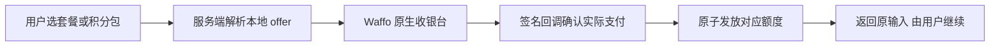

# FlowchartAI：实测用量与 Waffo 计费 V1 建议

日期：2026-10-14，Asia/Shanghai。状态：本地评估，未实施、未上线。

额度修订：按用户建议提高试用、订阅与积分包额度；保留原建议价格和 Token 计费基准。以下为修订后的待批准方案，实测回执未改写。

建议采用 **Waffo 新收款 + 按模型加权 Token 扣积分 + 两档订阅 + 两个永久积分包**。只展示积分余额、预计消耗和实际消耗；不引入额外服务器，也不因套餐限制复杂图的节点数、泳道或可编辑能力。

## 1. 实际测试结果

源码：`257662f9ac74c14ca4977c62562c370af771aae1`；与当前远端 main `a35223328b35816d00407d7eee522791f60d3138` 无文件内容差异。模型、知识、最大 5 步、16,000 输出 Token 上限和 reasoning 配置沿用发布版本。测试直接执行 Mastra 1.51、OpenRouter 3.1 和生产同源的原生图处理函数。保留复杂生成及三轮修改的完整用户/助手文字历史，每次附当前完整图结构。

所有模型调用均真实发生；费用来自每次 HTTP 响应 `usage.cost`，逐次求和，未用 Token 单价估算替代。当前实际供应商为 Baidu。用量包括必要的 Skill 激活/读取调用。没有调用线上应用 API、数据库、支付接口或用户积分接口。

| 场景 | 请求内模型调用数 | 输入 Token（含缓存） | 其中缓存输入 | 输出 Token | 实际费用 USD | 耗时 | 按下方建议费率模拟扣点 |
| --- | ---: | ---: | ---: | ---: | ---: | ---: | ---: |
| 简单订单发货图 | 1 | 3,866 | 1,024 | 535 | 0.00174945 | 9.2 秒 | 9 |
| 复杂退款泳道图 | 3 | 14,035 | 8,192 | 2,413 | 0.00496697 | 35.5 秒 | 23 |
| 连续修改 1：3 次重试、60 秒等待 | 2 | 19,305 | 10,240 | 642 | 0.00490116 | 11.7 秒 | 23 |
| 连续修改 2：风控与主管人工复核 | 1 | 10,384 | 1,024 | 1,554 | 0.00549450 | 20.9 秒 | 26 |
| 连续修改 3：跨区域样式、改名、嵌套组 | 2 | 25,057 | 12,288 | 1,506 | 0.00735306 | 21.4 秒 | 35 |
| 平台修复：删除误生成的孤立节点 | 1 | 12,213 | 1,024 | 190 | 0.00510100 | 4.7 秒 | 0，平台承担 |

前三个场景共 5 个正常用户请求、9 次模型调用，费用 **$0.02446515**。三轮复杂修改合计输入 54,746、输出 3,702、缓存输入 23,552 Token，费用 **$0.01774873**，模拟扣 84 积分。追加一次平台修复后，全部测试 10 次模型调用，实际总费用 **$0.02956615**。所有调用都有完整费用字段，没有漏计未知费用。

### 输出检查

- 简单图：9 个业务节点、8 条连线。
- 复杂生成：27 个业务节点、5 个部门泳道、1 个嵌套组、31 条连线，包含并行、汇合、补交、更正和支付重试。
- 三轮修改均为局部 `patch`，不是全图替换。加入初始化/上限判断/递增，插入风控与人工复核，修改财务 5 个节点的颜色和标签，并新增主管嵌套组。
- 原业务节点 ID 保留；第 3 轮没有改变原连线或支付重试节点的摘要、样式与几何信息。
- 第 2 轮误生成一个没有连线的冗余节点 `cs_risk_reject`，第 3 轮保留了它。因此不能把原始五次输出全部称作无瑕疵通过。追加修复只删除这个节点，其余对象摘要不变；最终无孤立业务节点，34 个业务节点、7 个组、40 条连线。
- 本轮检查原生文档结构与修改结果，没有重做浏览器视觉、Undo、保存或支付验收。

### 数据含义

这是三个场景的小样本，不能据此给出成功率、平均成本、P95 或极长上下文承诺。连续修改的差异同时受上下文、输出量、调用步数和缓存影响，不能全部归因于历史变长。本轮没有测试 100k 以上上下文或几十轮对话。

复杂生成最后一次调用的费用是 $0.00270387，整个任务是 $0.00496697；只读最后一步会少计约 **46%**。账务必须汇总整次任务的全部调用，并把缓存输入从普通输入中分离。当前原生图主要写结构化图数据，布局在本地计算，所以实际输出比完整 XML 小；不能用节点数直接推断费用。

证据：[逐次用量回执](billing-v1-2026-10-14/usage-results.json)、[结构检查](billing-v1-2026-10-14/verification.json)、[简单图](billing-v1-2026-10-14/simple-generation.drawio)、[复杂初始图](billing-v1-2026-10-14/complex-generation.drawio)、[最终修复图](billing-v1-2026-10-14/complex-platform-repair.drawio)。本地测试脚本在工作树根目录 `.env.billing-cost-probe.ts`；它不会被产品代码调用。

## 2. 积分消耗规则

采用稳定、版本化的模型计费表；供应商促销不实时改变用户费率。供应商真实费用独立记录用于成本核对。下表是 **拟议计费基准，不是本次供应商实际价格**。

| 当前路径的模型 | 普通输入／1,000 Token | 缓存输入／1,000 Token | 输出／1,000 Token |
| --- | ---: | ---: | ---: |
| 原生文字生成/修改：DeepSeek V4 Pro | 2 积分 | 0.2 积分 | 4 积分 |
| 旧编辑器文字：DeepSeek V4 Flash | 0.2 积分 | 0.05 积分 | 0.4 积分 |
| 图片理解：Seed 2.0 Mini | 0.2 积分 | 未验证，不假设缓存折扣 | 0.8 积分 |

默认原生文字模型按 **$2／$0.2／$4 每百万普通输入／缓存输入／输出 Token** 设置保守计算基准，1 积分对应 $0.001 标准计算预算。这不代表积分可兑换美元。参考的是非最低促销报价，避免用今天很低的价格承诺长期无限量。旧编辑器和图片路径的费率是根据官方报价拟议的初值，本轮未实测这两个路径，不给出生成次数承诺。

计算：先对每次调用 `(普通输入 × 输入费率 + 缓存输入 × 缓存费率 + 输出 × 输出费率) / 1000`，累加任务内计费调用，**整次任务最后向上取整一次**。例如本次复杂生成 22.9764 → 23 积分。最低 1 积分仅适用于有模型调用的有效结果。内部用整数最小单位保存，不逐步四舍五入。

规则：

1. AI 生成、修改、读图和实际模型回答统一按模型用量计入；必要知识读取的模型步骤属于该任务。纯本地工具执行不额外按次扣点。
2. 手动编辑、查看、保存、撤销和下载免费。
3. 先预留预算，结果成功提交后结算，退回未使用的预留。重复刷新/回调/重连不再次扣款，同一任务能恢复原结果。
4. 系统失败、格式错误的修正以及本次这类平台生成瑕疵的修复由平台承担，仍完整记成本。修复关联原任务，由服务端识别，不由客户端声明免费。
5. 结果未提交前取消，释放预留；结果已经提交，已完成消耗不因关闭页面返还。初版一次只运行一个未完成的 AI 任务，避免重复发送形成多次消耗。
6. 请求前显示预计积分。普通任务直接运行；预估超出默认预算时显示本次最高消耗，用户确认后继续。达到确认上限不默默继续扣款，也不在 XML 输出中途截断并交付损坏结果。
7. 后端记录每次调用的输入/输出/缓存/推理 Token、实际费用、generation ID、任务 ID、模型及计费版本。推理已包含在输出计费时不重复加算。
8. 固定计费表需配套限制同模型的高价后备路由并核对缓存单价。正常文字基准输入 $2、输出 $4／百万 Token，路由费用超出预算时由平台处理或调整下一版费率，不事后涨价补扣用户。不得为省钱静默降低复杂图的模型质量。

用户界面只展示一个总余额、预计/实际消耗和“购买积分”。不加入 Token 仪表盘或 5 小时/周双限额；技术明细放入可展开的消耗记录。

## 3. 套餐与积分包

以下均为待批准的新购买方案，USD；税费以真实结账页为准。新价格不会自动应用到现有 Creem 订阅。

| 产品 | 月付 | 年付 | 积分 | 按本次复杂生成 23 分估算 |
| --- | ---: | ---: | --- | --- |
| Free | $0 | — | 注册一次赠 200，30 天有效 | 可完成一次复杂生成及三轮本次规模的修改，合计 107 分 |
| Starter | $9 | $90，一年省 $18，约 17% | 每订阅月 2,000 | 每月约 80 次复杂生成 |
| Pro | $19 | $190，一年省 $38，约 17% | 每订阅月 6,000 | 每月约 260 次复杂生成 |
| 小积分包 | $10，一次性 | — | 1,500，永久有效 | 约 60 次复杂生成 |
| 大积分包 | $30，一次性 | — | 5,000，永久有效 | 约 210 次复杂生成 |

次数仅帮助理解价值，不能代替按实际 Token 结算；长上下文和较大输出消耗更多。套餐使用同一模型质量和原生编辑能力，不把泳道、复杂分组、自然语言修改、保存或普通下载做成更高档的限制。区别只在额度与价格。Pro 每美元积分更多，较大积分包单价更低，两档订阅仍优于积分包单价；积分包提供随用随买、不过期的价值。

额度规则：

- 月付按支付确认的订阅月发放，不按自然月。年付一次收全年费用，仍每订阅月发放；不会一次发出全年积分。
- 订阅积分当期有效、不结转；年付在整个已付年内按月继续发放。取消只停止下一次收费，不取消已付期间权益。
- 积分包无需会员，可以直接购买，永久有效。先消耗即将到期的积分，再消耗永久积分。
- Free 是一次注册试用，不自动每月赠送。历史赠送积分、已购余额和流水保留，不能因新政策清零或改写。
- 初版套餐升降级统一下期生效，避免按日计算积分补差；当期不够可买积分包。Waffo 托管确认页需明确生效日期。
- 退款建议：首次购买后 7 天内、购买的额度完全未消耗时可申请退款；退回原付款渠道并收回对应未用额度，不动其他来源余额。已消耗或后续购买按公开退款政策处理并保留可用结果。正式条款和收款页必须同步；这只是拟议政策。
- 退款不自动停止 Waffo 续费，涉及退出订阅时需单独取消续费。拒付/撤销付款只处理对应订单的余额与权益；不删除历史流水。

## 4. Waffo 收款与旧用户过渡

Waffo 负责新月付/年付订阅和一次性积分包；积分发放、消耗、有效期、结果恢复由 FlowchartAI 负责。

- 只认签名回调和可信支付记录。支付返回链接、客户端“成功”、Checkout 创建都不能发积分。
- 相同订单/订阅月/任务各只处理一次；前端不能传任意商品价格或赠送数量。
- 保留 Creem 的续费、取消、退款和 Portal；新 Checkout 走 Waffo。订单明确记录 provider 和本地 offer，不依靠一个全局 provider 开关路由历史账务。
- 现有代码的 Creem webhook 使用全局 `getPaymentProvider()`。直接全局替换会影响旧回调；必须先按 provider 独立分发，再切新销售入口。
- Waffo 官方迁移可复制商品与部分配置，但不能复制有效订阅或付款方式。现有订阅保持原价格/周期/权益，用户到期后主动确认新方案、重新订阅。迁移不能造成两边同时自动续费。
- 原固定次数订阅在旧合同有效期间仍按旧权益执行，后台可只读记录成本；不把旧余额/旧权益擅自折成更小的新额度，也不追溯扣费。
- `canceling` 保留当前已付期权益；续费成功后只发新期一次额度。延期发放按可信周期确认，不能按一次页面访问重复送分。
- 计划变更还需处理 `plan_changed` 等实际回调，不能只处理 activated/canceled。初版明确设置下期生效，避免即刻按日补差的复杂度。
- 购买返回后保留输入和现有图，刷新可信余额；由用户确认继续，不自动提交生成。
- 当前提示词筛查依赖 Creem；迁移时单独确定这条内容筛查路径的归属，不能因为换支付入口顺带失效。

FlowchartAI 对应 Waffo 店铺的商户审核、生产商品和回调配置本轮没有登录核验；方案不代表已能切换生产收款。

## 5. 成本边界

Waffo 卡/数字钱包交易费 3.9% + $0.50；提现另为 1%，每次最低 $10；退款 $1／次，原交易费不退。下表仅按标价扣卡交易费，再按每积分 $0.001 的标准计算预算预留模型支出。**不代表净利润**，未计税款、充值手续费/汇率、提现、托管、售后和平台失败修复费用。

| 产品 | 卡交易费后金额 | 标准模型预算 | 其余费用前余额 |
| --- | ---: | ---: | ---: |
| Starter 月付 | $8.149 | $2 | $6.149 |
| Pro 月付 | $17.759 | $6 | $11.759 |
| Starter 年付 | $85.99 | $24 | $61.99 |
| Pro 年付 | $182.09 | $72 | $110.09 |
| 小积分包 | $9.11 | $1.5 | $7.61 |
| 大积分包 | $28.33 | $5 | $23.33 |

建议再预留标准模型预算的 50% 给失败、取消和平台修复。例如 Pro 月付另预留 $3 修复余量，剩 $8.759 支撑其他费用；Pro 年付另预留 $36，剩 $74.09。Starter 月付另预留 $1，剩 $5.149。50% 是保守运营假设，不是从这 6 次任务估计的失败率。实际费用必须持续核对；本次 Baidu 促销与缓存使费用较低，不能据此承诺长期 95% 毛利。

若仅按本次 5 个正常任务模拟扣点 116 分、连同平台修复实际花费 $0.02956615 的比例外推，Pro 6,000 分对应约 $1.53 模型支出，Free 200 分对应约 $0.051。这个比例只说明提高额度有空间；不是月度账单预测，不替代上面的常规费率及修复预算。

## 6. 最小落地范围与验证

只需现有 Next.js/Mastra 与数据库：

1. 在 Agent 服务端记录完整调用、费用与任务状态；现有客户端 `tokensUsed: 0` 只作旧统计，不能继续作为资金依据。
2. 增加积分来源/有效期及预留/结算记录；原子扣减和订单、订阅月、任务唯一标识是资金完整性要求。查询余额后绝对值覆盖写入需要替换，以免并发覆盖。历史记录保留。
3. 建立本地商品表、Waffo provider 和独立 webhook；保留 Creem 路由及旧 Portal。价格、额度由服务端商品表决定。
4. 更新定价页、购买摘要、余额和消耗记录。年付/月发、包不过期、默认取消规则在收银台前可见。
5. 年付月度积分可在用户读取余额/发起 AI 时按已付订阅周期原子补齐当前月，不补发过期闲置月；不需要额外常驻服务。预留发生在到期前的任务使用该预留完成结算，不能因月界变更产生多扣。

实现后的最低验收保持简单：复用这三个 AI 场景；Waffo sandbox 只测一笔订阅和一笔积分包，再重放回调确认只发一次；测试失败释放、任务重连不多扣、订阅到期与永久积分包独立、取消后已付期保留、旧 Creem 回调仍正常。先本地与 sandbox，不对现网自动迁移、建商品、改余额或发布。

本轮只新增本地测试和研究证据。没有修改产品源码、线上环境变量、支付配置、用户数据库、会员状态或余额。

## 官方依据

- [OpenRouter 用量和实际费用回传](https://openrouter.ai/docs/cookbook/administration/usage-accounting)：逐次 usage、缓存、费用和 generation ID。
- [OpenRouter 原生模型报价](https://openrouter.ai/deepseek/deepseek-v4-pro)、[旧模型报价](https://openrouter.ai/deepseek/deepseek-v4-flash)、[图片理解模型报价](https://openrouter.ai/bytedance-seed/seed-2.0-mini)：不同模型/供应商/缓存费率和促销。
- [OpenRouter 供应商路由](https://openrouter.ai/docs/guides/routing/provider-selection)：供应商与价格上限能力。
- [Waffo 手续费](https://docs.waffo.ai/mor/fees)：交易、退款、提现费用。
- [Waffo 迁移](https://docs.waffo.ai/integrate/migrate)：有效订阅与付款方式不迁移，过渡期双 provider。
- [Waffo 订阅生命周期](https://docs.waffo.ai/features/subscriptions)：取消后有效期、退款不停止续费、计划变更确认与事件。
