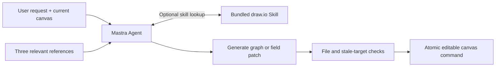

# Native Agent knowledge

The native and legacy assistants both run through Mastra Agent/createTool. The native Agent attaches `drawio-native`, defined in `src/lib/mastra/drawio-knowledge.ts`. Its seven references are in-memory strings bundled with the application. No extra server, filesystem workspace, embedding API or vector database is needed.

References cover shapes/styles, containers/relative coordinates, connections, complex flow examples, ER, sequence/timeline, architecture/tree/UML. Request text selects relevant context first, with the existing family as fallback. This selection never rejects an edit or removes a tool. The current document alone supplies IDs, parents, geometry, styles and revision; examples explain patterns and have no reusable fixture IDs.

Three references are preloaded so normal requests need no lookup round. Mastra exposes `skill`, `skill_read` and `skill_search` for further guidance. A reference path is `references/styles.md`, for example. Native has a five-step total budget for optional lookups and correction; a valid drawing result ends the loop immediately. The existing SSE mapper ignores knowledge results and emits only validated drawing commands.

Guidance is authored/adapted from [draw.io style documentation](https://www.drawio.com/docs/reference/diagram-generation/style-reference/) and [jgraph's XML reference](https://github.com/jgraph/drawio-mcp/blob/main/shared/xml-reference.md), reviewed on 2026-10-13 against the pinned v32.0.2 renderer. [Mastra Skills](https://mastra.ai/docs/skills) supplies the loading mechanism. Original MCP parameters/tools such as `routing:libavoid`, `postLayout` and `search_shapes` are not part of our contract. Our graph compiler handles creation XML and escaping; the guides use its actual style map and patch fields.

The parallel/risk/retry examples are product-specific lessons from accepted diagrams. Add a compact pattern here when a real failure reveals a reusable correction, then rerun that example. Knowledge changes remain reviewable source changes; this implementation does not train a model or automatically ingest user data. Other families have guidance and native tool access, while the current real-model acceptance focuses on complex flowcharts.
